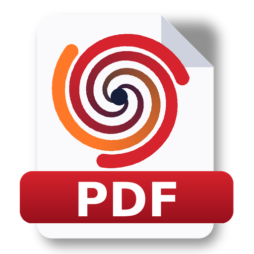

<p align="center"></p>

<h1 align="center">Vorticis PDF Editor</h1>

<p align="center">Visualizador, editor e conversor de PDF <b>gratuito</b> para Windows. É prático e rápido.</p>

---

## Download

Na aba **[Releases](../../releases)** há dois arquivos separados:

| Arquivo | O que é |
|---|---|
| **`VorticisPDF-Instalador-x.y.z.exe`** | Instalador. Cria atalhos e pode adicionar o menu do botão direito. **Não pede senha de administrador**, porque instala para o usuário atual. |
| **`VorticisPDF-Portatil-x.y.z.zip`** | Versão portátil, sem instalação. Descompacte e execute `VorticisPDF.exe`. Funciona até de um pendrive, e configurações, histórico e logs ficam na pasta `dados`, ao lado do programa. |

Requer Windows 10 ou 11 (64 bits). Nenhuma outra instalação é necessária, porque o Python e as bibliotecas já vão embutidos.

O build automático testa cada versão num Windows limpo antes de publicá-la. O teste instala sem administrador, executa o autoteste (`VorticisPDF.exe --selftest`, que abre, edita, une, separa e converte), confere o menu do botão direito e desinstala. A versão portátil passa pelo mesmo autoteste.

> **"O Windows protegeu o computador" (SmartScreen):** esse aviso aparece para qualquer programa novo sem certificado digital pago. Ele não indica problema no arquivo. Clique em **Mais informações › Executar assim mesmo**. Para conferir a integridade dos downloads, use o `SHA256SUMS.txt` publicado junto com cada versão. Projetos de código aberto podem obter assinatura gratuita pelo [SignPath Foundation](https://signpath.org), o que remove o aviso.

## Funcionalidades

### Visualizar
* Rolagem contínua das páginas. Só as páginas visíveis são renderizadas, então mesmo arquivos grandes abrem rápido.
* Zoom por `Ctrl` + roda do mouse, `Ctrl` `+` / `-`, ajuste à largura ou página inteira, além de 25 % a 400 %.
* Painel de **miniaturas** com tamanho ajustável (controle deslizante ou `Ctrl` + roda) e **visualização ampliada** de qualquer página (barra de espaço ou duplo clique).
* Busca de texto (`Ctrl+F`), seleção e cópia de texto.

### Selecionar texto, sem escolher ferramenta
* **Clique e arraste sobre o texto** com o botão esquerdo para selecioná-lo na ordem de leitura, como num editor de texto. A seleção pode abranger várias linhas.
* **Clique duplo** seleciona a palavra, **clique triplo** seleciona a linha, `Shift`+clique estende a seleção e `Ctrl+A` seleciona todo o texto da página.
* Arrastar numa **área sem texto** move a página, como a ferramenta mão.
* Com o **botão direito sobre a seleção**: copiar, destacar, sublinhar, riscar, traduzir ou localizar no documento. Fora da seleção, o mesmo botão oferece: adicionar texto, nota, forma ou imagem no ponto clicado, girar a página e inserir página em branco.
* Também funciona em documentos digitalizados depois do OCR.

### Criar um PDF do zero
**Arquivo › Novo PDF** (`Ctrl+N`), ou **Novo PDF** na tela inicial:
* tamanhos A4, A3, A5, Carta, Ofício, Legal, cartão 10 × 15 cm ou personalizado (em mm), em retrato ou paisagem;
* de 1 a 500 páginas;
* fundo **em branco, pautado, pautado com margem, quadriculado ou pontilhado**.

Depois é só clicar na página para escrever e usar formas, imagens, desenho livre e assinatura.

### Formas
Ferramenta **Formas** (`F`) na barra lateral:
* **retângulo, elipse/círculo, linha, seta, seta dupla, triângulo, losango, estrela, visto (✓) e xis (✗)**;
* a barra de opções define a cor do contorno, o preenchimento, a espessura, a opacidade e o tracejado;
* segure `Shift` para obter quadrado ou círculo perfeito e linhas a 0°, 45° ou 90°;
* **Desenho livre** (`D`): desenhe à mão com o mouse.

Todas as formas continuam editáveis: clique para selecionar, arraste para mover, use a alça do canto para redimensionar e `Delete` para excluir. O botão direito sobre a forma muda cor, preenchimento, espessura, opacidade e tracejado. As formas são gravadas como anotações PDF padrão, então também podem ser editadas em outros leitores.

### Editar
| Ferramenta | Atalho | O que faz |
|---|---|---|
| Editar texto | `E` | Passe o mouse sobre um texto para ver a fonte na barra de status e clique para editá-lo. **A fonte original é reconhecida e mantida** (veja abaixo) |
| Adicionar texto | `T` | Insere texto em qualquer ponto, com qualquer fonte instalada |
| Destacar | `M` | Marca-texto sobre as palavras |
| Apagar área | `W` | Remove definitivamente o conteúdo da área (redação) |
| Nota | `N` | Comentário (post-it) |
| Imagem | `I` | Insere uma imagem (assinatura, logotipo…) |
| Recortar | `C` | Recorta a área visível de uma página ou de todas |

Para desfazer e refazer use `Ctrl+Z` / `Ctrl+Y`. Os 20 últimos passos ficam guardados.

### Reconhecimento automático de fontes
Ao editar um texto, o programa procura a fonte nesta ordem:
1. a **fonte embutida no próprio PDF**, se tiver todos os caracteres necessários;
2. a **mesma fonte instalada no Windows**, comparando nome PostScript, nome completo e família + estilo (`ABCDEF+Arial-BoldMT` é reconhecida como *Arial Bold*);
3. uma **fonte equivalente**, como Arial ↔ Liberation Sans, Calibri ↔ Carlito ou Times ↔ Liberation Serif;
4. as **fontes padrão do PDF** (Helvetica, Times, Courier), mantendo negrito, itálico, serifa e monoespaçamento.

O editor de texto mostra a fonte detectada: nome, estilo, tamanho, cor, tipo e se está embutida. Também mostra a fonte que será usada e uma **prévia ao vivo nessa fonte**. Se algum caractere digitado não existir na fonte embutida (PDFs costumam embutir só os caracteres usados), o programa avisa e usa a mesma fonte instalada no computador.

**O texto digitado não sobrescreve linhas e marcações:**
* só os caracteres do trecho editado são removidos, e as linhas de texto vizinhas, bordas de tabela, sublinhados, retângulos e imagens permanecem intactos;
* se o novo texto for maior que o espaço disponível (até o próximo texto, borda de célula, linha vertical ou margem), o tamanho da fonte é ajustado automaticamente para caber. Essa opção pode ser desligada;
* ao adicionar texto num ponto já ocupado, o programa avisa antes de inserir.

Todas as fontes instaladas entram na lista: `C:\Windows\Fonts`, as fontes do usuário e qualquer arquivo copiado para `%APPDATA%\Vorticis PDF Editor\fonts`. Também entram as 14 fontes padrão do PDF e as fontes CJK. A janela de edição mostra a fonte original e a fonte reconhecida, e você pode escolher outra. Em **Arquivo › Propriedades e fontes** aparece a lista das fontes do documento com a fonte correspondente no sistema.

### Organizar páginas
* **Modo Organizar** (`F6`): miniaturas grandes em grade. Arraste para reordenar, use `Shift`/`Ctrl` para selecionar várias páginas e solte arquivos de fora para inseri-los na posição exata.
* **Botão direito** sobre as miniaturas: girar, mover para o início ou o fim, duplicar, inserir página em branco, inserir arquivo, extrair para novo PDF, separar aqui, imprimir seleção, inverter ordem, selecionar páginas pares ou ímpares, excluir.

### Unir, separar e imprimir
* **Unir**: aceita PDFs, Word, Excel, PowerPoint, imagens e outros formatos, que são convertidos automaticamente. Arraste para definir a ordem e use **Adicionar pasta** para incluir todos os arquivos de uma pasta. Cada arquivo vira um marcador no PDF final.
* **Separar**: uma página por arquivo, a cada N páginas, por intervalos (`1-3, 4, 5-`) ou ao meio. Funciona com vários PDFs de uma vez.
* **Imprimir** (`Ctrl+P`): imprime na ordem atual das páginas, com pré-visualização. Páginas em paisagem giram automaticamente.

### Converter
| De → Para | Como |
|---|---|
| Imagens (PNG, JPG, TIFF, BMP, GIF, WEBP), XPS, EPUB, CBZ, FB2, SVG, TXT → PDF | Nativo |
| Word, Excel, PowerPoint, ODF, RTF, CSV, HTML → PDF | Pelo **LibreOffice** (gratuito) ou pelo **Microsoft Office**, se estiver instalado. Sem nenhum dos dois, faz uma conversão simplificada de DOCX, XLSX, CSV e HTML |
| PDF → Word (.docx) | Mantém o layout (pdf2docx) |
| PDF → Excel (.xlsx) | Uma planilha por página. Tabelas são detectadas, e as colunas são montadas a partir das linhas de texto |
| PDF → PowerPoint (.pptx) | Um slide por página, com o texto nas notas |
| PDF → PNG / JPG / TIFF, TXT, HTML, Markdown, ODT, PDF otimizado | Nativo |

### Menu do botão direito no Windows Explorer
Ative pelo instalador ou em **Ferramentas › Adicionar ao menu do botão direito**. Não exige administrador. Depois disso, selecione os arquivos numa pasta, clique com o botão direito e escolha **Vorticis PDF**:

* **PDF**: Abrir · **Unir PDFs selecionados** · **Separar PDF** · **Organizar páginas** · Imprimir · Converter PDF para…
* **Office e imagens**: Converter para PDF · Unir como um único PDF · Abrir

Se vários arquivos estiverem selecionados, o Vorticis junta todos numa única operação. Também são criados atalhos em **Enviar para** (*Vorticis - Unir em PDF* e *Vorticis - Organizar páginas*).
> **Windows 11:** por padrão, o Windows esconde as opções de programas em "Mostrar mais opções". O instalador já oferece, marcada, a opção **"Windows 11: mostrar as opções direto no botão direito"**. Ela também pode ser ligada ou desligada em **Ferramentas › Windows 11: mostrar as opções direto no botão direito**.
> Essa opção ativa o menu completo do Windows (o mesmo de "Mostrar mais opções") diretamente, para todos os programas. Vale só para o seu usuário, não precisa de administrador e é desfeita ao desinstalar. Para aplicar, o Explorer é reiniciado uma vez.

### Informações de salvamento
* Depois de salvar, uma janela mostra o arquivo, a data e a hora, o número de páginas, o tamanho antes e depois, a proteção por senha e a **lista de alterações feitas**.
* A barra de status indica quantas alterações ainda não foram salvas. Ao fechar, o programa pergunta se quer salvar e lista as alterações.
* Os metadados do PDF são atualizados: data de modificação e produtor *Vorticis PDF Editor*.
* **Arquivo › Histórico de salvamentos** guarda todos os salvamentos, uniões e separações. O histórico fica em `%APPDATA%\Vorticis PDF Editor\historico_salvamentos.jsonl`.
* O salvamento é atômico: o arquivo é gravado num temporário e depois substituído, então uma falha não corrompe o original. As fontes são subconjuntadas para gerar arquivos menores.
* Opcionalmente, o PDF pode ser protegido com senha (AES-256) em **Propriedades › Segurança**.

### Linha de comando
```
VorticisPDF.exe arquivo.pdf
VorticisPDF.exe --merge a.pdf b.pdf planilha.xlsx
VorticisPDF.exe --split a.pdf
VorticisPDF.exe --organize a.pdf b.pdf
VorticisPDF.exe --print a.pdf
VorticisPDF.exe --convert a.pdf          (PDF → Word/Excel/...)
VorticisPDF.exe --to-pdf documento.docx  (Office/imagens → PDF)
VorticisPDF.exe --register-shell | --unregister-shell
```

### OCR: reconhecer texto de documentos digitalizados
**Ferramentas › Reconhecer texto (OCR)** (`Ctrl+Shift+O`). Funciona **sem internet** e sem instalar nada.
* **Tornar o PDF pesquisável:** adiciona o texto reconhecido como camada invisível. A aparência da página não muda, e o texto passa a poder ser pesquisado, selecionado, copiado e convertido para Word ou Excel.
* **Extrair o texto:** abre o texto reconhecido para copiar, salvar (`.txt` ou `.docx`) ou traduzir.
* Português, inglês e espanhol já vêm incluídos. Outros 20 idiomas (francês, alemão, italiano, japonês, chinês, russo, árabe...) podem ser baixados uma única vez pela própria janela.
* Há três níveis de qualidade (200, 300 ou 400 dpi). As páginas que já têm texto digital podem ser ignoradas.
* Ao abrir um PDF sem texto, o programa sugere o OCR.

### Tradução
**Ferramentas › Traduzir documento** (`Ctrl+Shift+L`). Usa um serviço on-line gratuito, sem cadastro, e por isso requer internet.
* **Novo PDF traduzido mantendo o layout:** cada bloco de texto é trocado pela tradução no mesmo lugar, com tamanho ajustado, sem apagar imagens, linhas ou tabelas.
* **Somente o texto:** abre a tradução lado a lado com o original, para copiar ou salvar.
* São 30 idiomas, com detecção automática do idioma de origem. Em documentos digitalizados, faça o OCR antes de traduzir.

### Assinatura digital com certificado (ICP-Brasil)
Use a ferramenta **Assinar** na barra lateral (`G`) e arraste a área onde o carimbo deve aparecer. Para assinar sem carimbo, use **Ferramentas › Assinar digitalmente (invisível)**.
* **Certificado A1:** arquivo `.pfx` ou `.p12`, com senha.
* **Certificado A3:** token USB ou cartão inteligente, com PIN. O driver do fabricante é detectado automaticamente: SafeNet, Watchdata, GD/Valid, Oberthur, Feitian, Bit4id, OpenSC e outros. Também é possível indicar a `.dll` manualmente.
* Segue o padrão **PAdES** (o mesmo usado pelo gov.br e pelo ITI). O carimbo visível mostra nome, CPF ou CNPJ lido do certificado ICP-Brasil, data e motivo. O motivo, o local e o contato podem ser preenchidos.
* **Carimbo do tempo** opcional, por servidor gratuito, para comprovar a data da assinatura.
* O arquivo original não é alterado, porque a assinatura é gravada num novo arquivo `_assinado.pdf`. Se você tentar salvar alterações sobre um PDF assinado, o programa avisa e oferece salvar uma cópia.
* **Ferramentas › Verificar assinaturas digitais** mostra o signatário, o CPF ou CNPJ, a data e a integridade. Também mostra se o documento foi **alterado depois de assinado** e se o certificado é de uma autoridade confiável instalada no Windows.

### Tema escuro e idioma
* **Exibir › Tema:** *Seguir o Windows* (padrão), *Claro* ou *Escuro*. O botão ☾ / ☀ na barra superior alterna entre eles (`Ctrl+Shift+T`).
* Toda a interface está em **português do Brasil**, inclusive os botões e janelas padrão do sistema (Salvar, Cancelar, seletor de arquivos, impressão, cores) e as mensagens de erro técnicas mais comuns.

### Diagnóstico de erros
Se algo der errado, o programa mostra uma mensagem e continua aberto. Os detalhes, inclusive falhas internas, ficam em **Ajuda › Abrir registro de erros** (`vorticis_erros.log`).

## Compilar a partir do código-fonte

Requer Python 3.10 ou superior no Windows:

```bat
build_windows.bat
```

O script baixa os modelos de OCR e gera `dist\VorticisPDF\VorticisPDF.exe`. Se o [Inno Setup](https://jrsoftware.org/isinfo.php) estiver instalado, também gera o instalador em `installer\Output\`.

Para rodar sem compilar:

```bat
pip install -r requirements.txt
python tools/fetch_tessdata.py
python vorticis.py
```

O ícone pode ser gerado de novo com `python tools/make_icon.py`.

### Estrutura
```
vorticis_pdf/
  app.py               entrada, linha de comando, instância única
  main_window.py       janela principal, barras de ferramentas e menus
  viewer.py            visualizador com zoom e ferramentas de edição
  thumbnails.py        miniaturas (arrastar, menu do botão direito, zoom)
  document.py          operações de PDF, desfazer/refazer, salvamento, unir/separar
  fonts.py             catálogo de fontes e reconhecimento automático
  converters.py        conversões entre formatos
  dialogs.py           diálogos (texto, unir, separar, converter, salvamento, propriedades)
  printing.py          impressão com pré-visualização
  ocr.py               OCR (Tesseract embutido no PyMuPDF)
  translate.py         tradução de textos e de PDFs mantendo o layout
  signature.py         assinatura digital A1/A3 (pyHanko, PAdES) e verificação
  features.py          diálogos de OCR, tradução e assinatura
  theme.py / icons.py  temas claro/escuro e ícones vetoriais
  i18n.py              tradução pt-BR dos componentes padrão do Qt
  shell_integration.py menu de contexto do Explorer (HKCU)
  single_instance.py   agrupa os arquivos selecionados no Explorer
```

## Licença
GNU AGPL-3.0, a mesma licença do PyMuPDF, que é a base do programa. É software livre e gratuito.
